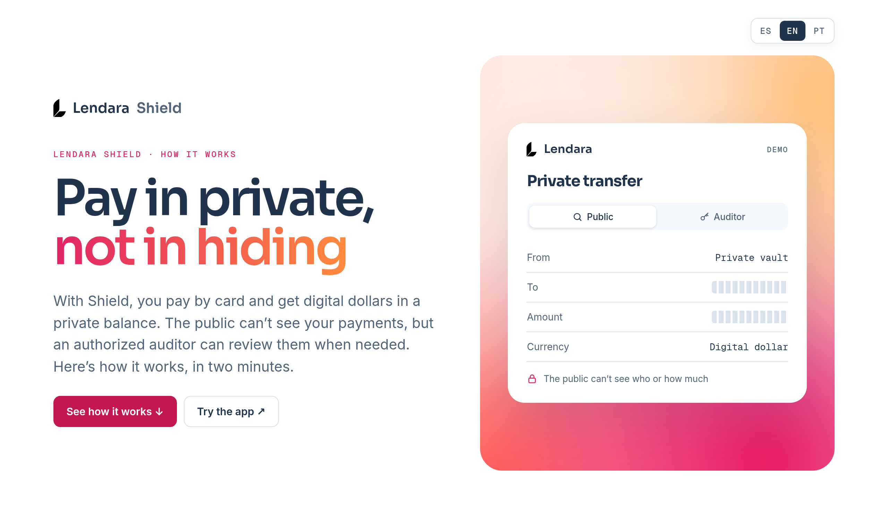
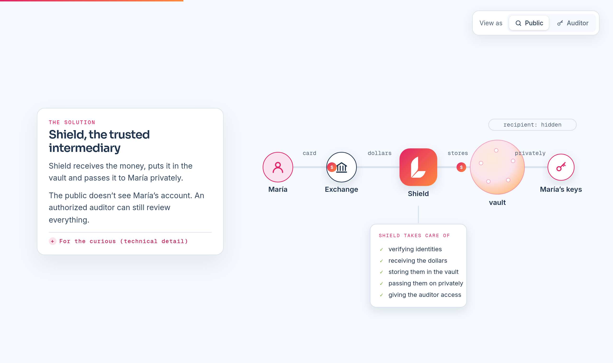
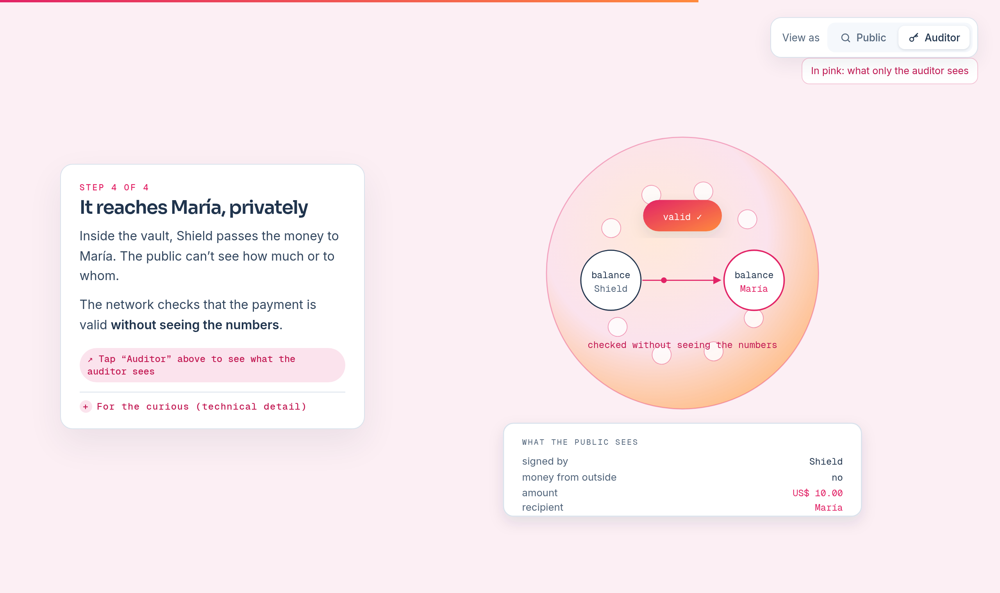
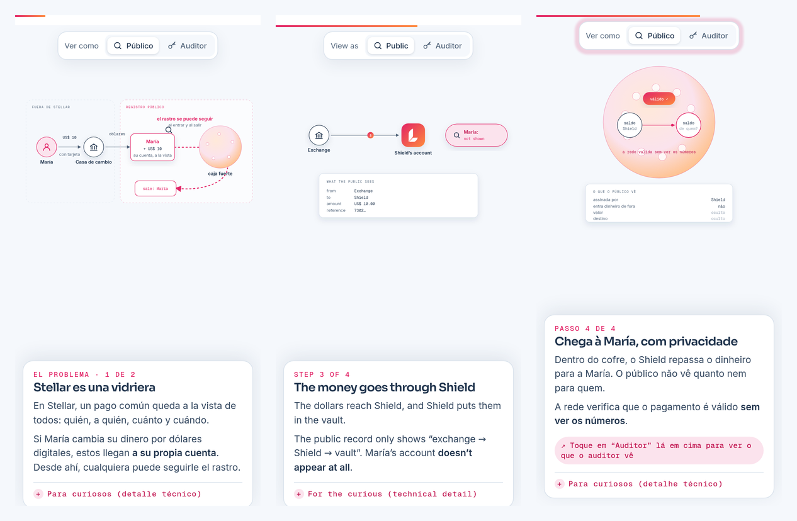

<div align="center">
  

  <h1>Lendara Shield · How it works</h1>

  <p><b>Pay in private, not in hiding.</b></p>

  <a href="https://lendara-org.github.io/shield-Interactive-explainer/"><b>▶ See it live</b></a>
  ·
  <a href="https://lendara-shield.duckdns.org/en">Try Lendara Shield</a>
  ·
  <a href="https://github.com/Lendara-Org/lendara-shield">Lendara Shield repo</a>

  <br><br>

  <a href="https://lendara-org.github.io/shield-Interactive-explainer/"></a>

  <br>

  <sub>🇪🇸 Español · 🇬🇧 English · 🇧🇷 Português — one page, pick your language at the top</sub>
</div>

## About

A short, scroll-through story that explains **Lendara Shield** to people who aren't technical.

On Stellar, a regular payment is visible to everyone: who paid whom, how much and when. Shield lets you pay by card and get digital dollars in a **private balance**. The public can't see your payments, but an **authorized auditor** can review them when needed.

You follow María as she adds US$ 10 with her card, step by step, in about two minutes.

<div align="center">
  
</div>

## What's inside

- **María's journey.** Eight short steps: the problem, the idea, and how card money becomes a private balance.
- **Public or auditor.** Flip a switch to see the same payment the way the public sees it and the way the auditor sees it. What only the auditor sees shows up in pink.
- **Who sees what.** Pick who's looking (the public, the exchange, Shield, the auditor or another user) and see exactly what each one can and can't see.
- **For the curious.** Each step has an optional, closed-by-default box with the technical detail, for developers who want it.

<div align="center">
  
</div>

## Works on any screen

Phone, phone held sideways, tablet, laptop and wide screens, in the three languages. The language is picked from your browser and can be changed with the **ES · EN · PT** switch.

<div align="center">
  
</div>

## Run it

It's a single `index.html` with no dependencies and no build step. Open it in a browser, or serve the folder:

```bash
python3 -m http.server 8000
```

Every push to `main` publishes the page to GitHub Pages.

## Good to know

- **Test version only.** Shield runs on Stellar's test network with test money. The private pool it uses (Stellar Private Payments, by Nethermind) is a developer preview with unaudited contracts. Don't use it with real money.
- María is an illustrative character and the amounts are examples. The 60-second timing comes from a real test run.

---

**ES:** Explicación interactiva de Lendara Shield para personas no técnicas: cómo pagar en privado en Stellar sin esconderse del auditor. Abrí la página en vivo o el `index.html`.

**PT:** Explicação interativa do Lendara Shield para pessoas não técnicas: como pagar com privacidade na Stellar sem se esconder do auditor. Abra a página ao vivo ou o `index.html`.

## License

[Apache-2.0](LICENSE)
